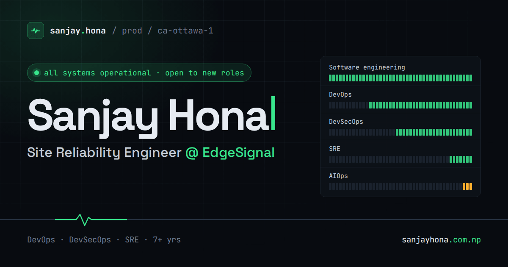

# sanjayhona.com.np

Personal site of **Sanjay Hona**, Site Reliability Engineer in Ottawa.

The home page is a desk. On a device that can run it, you get a 3D desk in the evening, and the computer on that desk holds the site: every part of it is a file you can open. Every number and date on it comes from real work history, not sample data.

**Live:** https://sanjayhona.com.np



## What's on the computer

| File | What it shows |
|---|---|
| `about.txt` | Name, role, disciplines, a short bio, and the "currently" block |
| `experience/` | One file per role, newest first |
| `stack.yaml` | Delivery → runtime → cloud, plus security and observability |
| `signals.json` | Career metrics: years in production, edge fleet size, MTTR, release frequency, env setup time, audit findings |
| `status.log` | Each discipline tracked like a service |
| `house-rules.md` | Operating principles |
| `contact.vcf` | Email first, LinkedIn second |
| Terminal | `ls`, `cat`, `open`, `status`, `kubectl get engineer` |

The rest of the desk works too: both lamps switch, the standing desk rises, the keys dip as you type, the wall clock keeps time, and the books, plant, laptop, phone and sticky notes each open a panel.

Three ways the page shows up:

- **3D desk**, where the device can run it. "turn off 3D" switches to the next one.
- **The desktop on its own**, filling the window, on weak devices, without WebGL, or after "turn off 3D" (`localStorage.rack = "off"`). Same files, same terminal.
- **A plain page**, with scripts off: the same files laid out one under another.

Press `/` or `⌘K` (`Ctrl K` on Windows/Linux) anywhere to open the command palette.

## Stack

- [Astro](https://astro.build) 7, static output, no client framework
- Plain CSS with design tokens; dark theme by default, light theme on toggle
- Self-hosted fonts via [Fontsource](https://fontsource.org): Space Grotesk, IBM Plex Sans, JetBrains Mono
- About 9 KB of client JavaScript: theme toggle, local clock, command palette, the desktop and its terminal, the 3D loader
- The desk is a [three.js](https://threejs.org) scene (about 165 KB gzipped), loaded lazily and only on devices that can run it
- Six objects on it are real 3D models from [Poly Haven](https://polyhaven.com) (CC0): the succulent, the architect lamp (repainted white), the spectacles, the notebook, the pencil cup and the wall clock, which shows your local time. About 1.3 MB in all, fetched only with the 3D scene. Sources and how they were prepared: [`public/models/CREDITS.md`](public/models/CREDITS.md). The rest is built in code. The plant, lamp and spectacles each have a simple built-in stand-in that stays if a file fails to load; the notebook, pencil cup and clock are just absent then
- Hosted on GitHub Pages behind Cloudflare, deployed by GitHub Actions
- No cookies. The site loads nothing from third parties itself; Cloudflare adds its Web Analytics beacon and Rocket Loader at the edge

## Edit the content

All copy and data live in two files. Components read from them, so most edits need no component changes.

| File | Controls |
|---|---|
| [`src/data/site.ts`](src/data/site.ts) | Name, contact, nav, signal panels, status rows, stack topology, principles, "currently" block |
| [`src/data/experience.ts`](src/data/experience.ts) | Roles, blurbs, impact chips, tags |

The bio prose and the windows live in [`src/components/DeskOS.astro`](src/components/DeskOS.astro); the list of files is [`src/data/desktop.ts`](src/data/desktop.ts). The 3D scene is [`src/scripts/rack.ts`](src/scripts/rack.ts).

## Run it locally

Requires Node 22 (same as CI).

```bash
npm ci
npm run dev       # http://localhost:4321
npm run build     # static output in dist/
npm run preview   # serve dist/
```

## Project layout

```text
src/
  components/   one file per section, plus TopBar, CommandPalette, SectionHead
  data/         site.ts and experience.ts (all content)
  layouts/      Base.astro: meta tags, JSON-LD, theme bootstrap
  pages/        index.astro and 404.astro
  scripts/      console.ts: theme, clock, nav highlight, palette, copy
                rack.ts: the 3D hero scene (mounted by components/Rack.astro)
  styles/       global.css: design tokens and shared primitives
public/         favicon, OG image, CNAME, robots.txt, web manifest
```

## Blog

The blog at [blog.sanjayhona.com.np](https://blog.sanjayhona.com.np) is a second Astro project in [`blog/`](blog/). It reuses the site's layout, top bar, command palette, styles, and CSP from `src/`, so both stay in one design.

Write a post by adding a Markdown file to [`blog/src/content/posts/`](blog/src/content/posts/). The filename becomes the URL:

```markdown
---
title: "Post title"
description: "One or two sentences for the index, search, and social cards."
date: 2026-09-22
tags: [sre, kubernetes]
takeaways:    # optional, 2 to 5 one-sentence answers shown above the post
  - "The main point, quotable on its own."
  - "The second point."
draft: true   # shows in dev only; remove to publish
---
```

```bash
npm run dev:blog      # http://localhost:4321
npm run build:blog    # static output in blog/dist/
```

**Scheduling:** give a post a future `date` and it stays hidden (index, page, RSS, sitemap) until that day. The blog workflow runs daily at 11:00 UTC (7:00 in Ottawa), builds, and deploys only when the built RSS feed lists different posts than the live one, so you can queue a week of posts at once and a failed run catches up the next day. Use a full timestamp such as `2026-10-01T13:00:00Z` for a specific time; it goes live at the first daily run after it. `npm run dev:blog` shows drafts and scheduled posts with a label. GitHub pauses scheduled workflows after 60 days with no repo activity; re-enable it under Actions if that happens.

It generates an RSS feed (`/rss.xml`), a sitemap with last-modified dates, tag pages, and a table of contents per post.

**Search engines and AI agents:** each post carries `BlogPosting` and `BreadcrumbList` JSON-LD tied to the portfolio's `Person` node by `@id`, plus `article:*` Open Graph tags. `takeaways` renders as a "key takeaways" box and becomes the JSON-LD `abstract`. Each post gets its own 1200×630 share card at `/og/<slug>.png`, drawn at build time by [`blog/src/lib/og.ts`](blog/src/lib/og.ts) with [satori](https://github.com/vercel/satori) and [resvg](https://github.com/yisibl/resvg-js) from the site's own fonts, so it looks the same on any build machine. For LLM tools there's [`/llms.txt`](https://blog.sanjayhona.com.np/llms.txt) (an index per [llmstxt.org](https://llmstxt.org)), `/llms-full.txt` (every post in one file), and a Markdown copy of each post at `/<slug>.md`. Those copies are `noindex`, so they don't compete with the HTML pages in search. `robots.txt` allows all crawlers, and none of these files include scheduled or draft posts. Response headers such as `X-Frame-Options` live in [`blog/public/_headers`](blog/public/_headers).

## Deploy

Every push to `main` runs [`.github/workflows/static.yml`](.github/workflows/static.yml), which builds the site and publishes `dist/` to GitHub Pages. The custom domain is set in the repo's Pages settings; [`public/CNAME`](public/CNAME) mirrors it. Cloudflare proxies the domain in front of Pages.

A few values are set at build time and refresh on each deploy: the commit hash in the footer, the status page's "updated" date and quarter cells, and the terminal's `AGE` column.

The blog deploys from [`.github/workflows/blog.yml`](.github/workflows/blog.yml) to Cloudflare Pages when `blog/` or the shared `src/` files change. A daily routine at claude.ai/code/routines writes one post about the past week's news, rotating through DevOps, SRE, AIOps, and cybersecurity, cites primary sources, and merges it so it goes live the same day. To steer it, add a topic or link under Queue in [`blog/ideas.md`](blog/ideas.md); to pull a post, delete its file. The deploy needs two repo secrets, `CLOUDFLARE_API_TOKEN` (scoped to Pages edit) and `CLOUDFLARE_ACCOUNT_ID`. Without them it builds and skips the deploy.

To roll back, revert the commit on `main`. The next deploy publishes the previous version.

## Dependencies and security

- **Dependencies:** Dependabot security updates open PRs right away. Version updates come monthly, grouped: one PR for npm minor/patch bumps, one for GitHub Actions ([`.github/dependabot.yml`](.github/dependabot.yml)). Run `npm audit` for the current state.
- **CI:** every action is pinned to a full commit SHA. `npm ci --ignore-scripts` means no dependency install scripts run. The build job's token is read-only, and only the deploy job can write to Pages.
- **Content-Security-Policy:** set as a `<meta>` tag from [`astro.config.mjs`](astro.config.mjs). Astro hashes the bundled scripts; [`Base.astro`](src/layouts/Base.astro) computes the hash of its inline theme script at build time, so editing that script can't leave a stale hash. Headers a `<meta>` tag can't carry (`frame-ancestors`, `X-Frame-Options`, `Permissions-Policy`, `Referrer-Policy`) come from a Cloudflare Response Header Transform Rule, defined in [`infra/cloudflare/security-headers.mjs`](infra/cloudflare/security-headers.mjs) and applied by [`.github/workflows/edge-headers.yml`](.github/workflows/edge-headers.yml). It uses `CLOUDFLARE_ZONE_TOKEN` if set, else `CLOUDFLARE_API_TOKEN`; the token needs Zone Read, Transform Rules Edit, and Zone Settings Edit on the zone. [`infra/cloudflare/hsts.mjs`](infra/cloudflare/hsts.mjs) keeps HSTS at 1 year with includeSubDomains and preload, the minimum for the browser preload list.
- **Surface:** plain static files. No backend, no forms, no secrets in the build.

## Contact

devops@sanjayhona.com.np · [LinkedIn](https://linkedin.com/in/sanjayhona)
